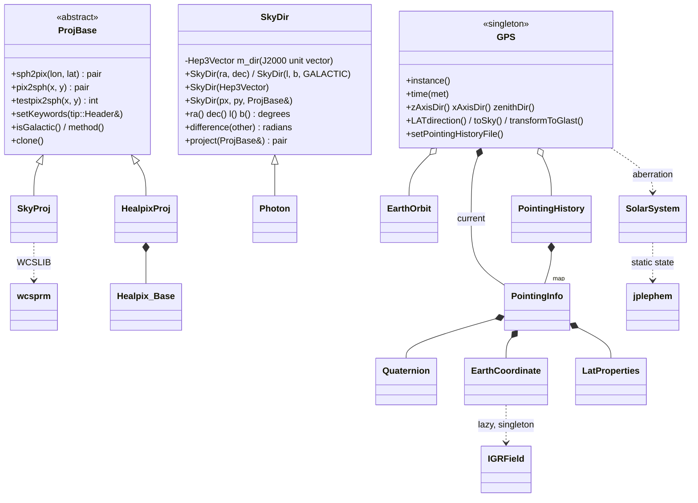

# astro Architecture

**astro** is the shared astronomy toolkit of the Fermitools. Its core is
`astro::SkyDir`, which nearly every science package uses to pass sky
positions around, plus `SkyProj`/`HealpixProj` for map pixelization. It also
holds a set of spacecraft-related classes that serve mostly the simulation
chain (`flux`, `celestialSources`, `observationSim`, `fitsGen`): the `GPS`
singleton, `PointingHistory` (an FT2 reader), `EarthOrbit`,
`EarthCoordinate` (with IGRF geomagnetic quantities and an SAA polygon), and
`SolarSystem` (a JPL DE405 ephemeris reader).

The Doxygen mainpage (`src/mainpage.h`, 2006) is stale. It lists
`astro::Healpix` and `astro::HealPixel`, which no longer exist (HEALPix
support is now `HealpixProj` over the external `healpix_cxx`). The
`IGRField.h` class comment says "IGRF-10, valid between 1990 and 2010", but
the code uses IGRF-13 coefficients with a hard 2025 limit. `doc/release.notes`
stops at astro-04-00-02 (2016); later history is in git.

## Purpose and scope

**Does:**
- Represent a direction on the sky (`SkyDir`) as a unit vector in J2000
  equatorial coordinates, with conversions to and from (RA, Dec) and
  Galactic (l, b) in degrees.
- Project sky coordinates to and from pixel coordinates through WCSLIB
  (`SkyProj`) or HEALPix (`HealpixProj`), behind a common `ProjBase`
  interface, and write the matching FITS keywords.
- Convert calendar dates and MET to Julian dates (`JulianDate`), with a
  hard-coded leap-second table.
- Model a circular low Earth orbit (`EarthOrbit`) and convert an inertial
  position to geodetic latitude, longitude and altitude
  (`EarthCoordinate`). Compute McIlwain L and B, invariant latitude and the
  magnetic field from IGRF (`IGRField`), and test for the SAA.
- Read FT2 spacecraft files, or a legacy ASCII format, and interpolate
  position and attitude in time (`PointingHistory`, `PointingInfo`,
  `LatProperties`).
- Provide a process-wide spacecraft model (`GPS`) that gives position,
  attitude and frame rotations at a given MET, from either a simulated
  orbit with a rocking strategy or a pointing history file.
- Return Sun, Moon and planet positions and the solar-system barycentre
  from the JPL DE405 ephemeris (`SolarSystem`).
- Small helpers: `Quaternion` (with SLERP), `PointingTransform`,
  `Photon` (a `SkyDir` with energy and time), `SkyFunction` (abstract
  functor on the sky), and `HTM`/`SkyStat` (hierarchical triangular mesh
  and statistics over it).

**Does not:**
- Do precise time-system conversions. There is no TT/TDB/UTC handling
  beyond the leap-second table in `JulianDate` and a TDB−TT series in
  `EarthOrbit`. The `gtbary` tool and its library are in `timeSystem`, which
  has its own copy of the JPL reader (`timeSystem/src/dpleph.c`).
- Handle precession, nutation or epochs other than J2000. `SkyDir` has
  only `EQUATORIAL` (J2000/FK5) and `GALACTIC`.
- Serve `Likelihood`'s exposure calculations. `Likelihood` reads FT2
  itself (`Likelihood/src/ScData.cxx`). `PointingHistory` and `GPS` are
  used by the simulation and FT2-generation tools.
- Ship the JPL ephemeris file. It must be supplied at runtime (see
  [Build and test](#build-and-test)).

## Position in the system

| Direction | Package | Why |
|-----------|---------|-----|
| Depends on | `facilities` | `PUBLIC`. `GPS.h` includes `facilities/Scheduler.h` and `facilities/Observer.h`. The library uses `commonUtilities::getDataPath("astro")` to find IGRF coefficient files, and `Util::stringTokenize`. |
| Depends on | `tip` | `PRIVATE`. `SkyProj` and `HealpixProj` constructors that read a FITS header, `ProjBase::setKeywords(tip::Header&)`, and `PointingHistory::readFitsData` (FT2 `SC_DATA`). Public headers only forward-declare `tip::Header`. |
| Depends on | CLHEP (`CLHEP::VectorS`) | `PUBLIC`. `Hep3Vector` and `HepRotation` appear throughout the public API. |
| Depends on | healpix_cxx | `PUBLIC`. `HealpixProj.h` includes `healpix_base.h` and exposes `Healpix_Base`. |
| Depends on | WCSlib | `PRIVATE`. Used only by `SkyProj.cxx`. The external is the bundled WCSLIB 7.1 (`externals/wcslib`). |
| Depends on | cfitsio | `PRIVATE`. The JPL ephemeris reader (`src/jplephem/`) and the `SkyProj(file, relax, ctrl)` constructor call cfitsio directly. |
| Used by | `Likelihood` | `SkyDir`, `SkyProj`, `HealpixProj`, `ProjBase` for every map class (`CountsMap`, `WcsMap2`, `BinnedExposure`, TS maps). |
| Used by | `irfs` | `SkyDir` throughout. `JulianDate` for CALDB epoch dates (`latResponse/src/CaldbDate.h`, `EpochDep.cxx`). |
| Used by | `celestialSources`, `flux`, `observationSim` | `GPS` (orbit, attitude, `LATdirection`/`toSky` frame rotations), `PointingHistory`, `EarthCoordinate` (SAA, geomagnetic latitude), `SolarSystem`, `JulianDate`, `PointingTransform`. |
| Used by | `fitsGen` | `EarthCoordinate` (`geolat()`, `insideSAA()` in `makeFT2`/`makeFT2a`), `JulianDate`, `Quaternion`. |
| Used by | `map_tools` | `SkyDir`, `SkyFunction`, `SkyStat`/`HTM` (`map_stats`), `PointingTransform`, `EarthCoordinate`, `GPS`. |
| Used by | `healpix` | `SkyDir`, `SkyFunction`, `Photon`, `SkyProj`. |
| Used by | `evtbin` | `SkyDir`/`SkyProj` for CMAP/CCUBE, `HealpixProj`. |
| Used by | `SolarSystemTools` | `SolarSystem` (Sun/Moon position), `SkyProj`, `SkyDir`, `JulianDate`, `PointingTransform`. |
| Used by | `st_facilities` | `SkyDir`, `ProjBase`/`SkyProj` (`Util::skyDir2pixel`, `FitsImage`), `JulianDate`. |
| Used by | `dataSubselector`, `rspgen`, `pyExposure` | `SkyDir`. `dataSubselector`'s `gtalign` also uses `GPS`. |
| Used by | `pyLikelihood` | SWIG-wraps `ProjBase`, `SkyProj`, `HealpixProj`, `SkyDir`, `JulianDate` and `SolarSystem` (`pyLikelihood/src/pyLikelihood.i`). This is the only Python exposure of astro in the CMake build. |
| Linked by | `BayesianBlocks` | CMake link only; no direct `#include`. |
| Not built | `skymaps` | Includes many astro headers, but `skymaps` is not part of the CMake build. |

astro depends on nothing above tier 0 except `tip`, which is why it sits in
tier 1 (`io`). The `GPS`/orbit/geomagnetic classes are instrument-flavoured
and are used almost only by the simulation chain, but they have no extra
dependencies, so they do not change the tier.

## Key abstractions

All public types live in namespace `astro`, with headers in `astro/`.



| Type | Header | Role |
|------|--------|------|
| `SkyDir` | `astro/SkyDir.h` | A direction, stored as a J2000 equatorial unit vector (`dir()`, or `operator()`). All angle accessors are in **degrees**; `difference()` returns **radians**. `CoordSystem` is `GALACTIC=0` or `EQUATORIAL=1` (the default). The Galactic rotation (`s_equatorialToGalactic`) uses the FK5→Galactic angles from astropy (changed in 2016). |
| `ProjBase` | `astro/ProjBase.h` | Abstract projection: `sph2pix`, `pix2sph`, `pix2pix`, `testpix2sph`, `range`, `setKeywords`, `clone`. `Method` is `WCS` or `HEALPIX`. Also defines `degToRad`, `radToDeg`, `latToTheta_*` and `ASTRO_D2R`-style macros. |
| `SkyProj` | `astro/SkyProj.h` | WCSLIB wrapper. Built from (projection code, CRPIX, CRVAL, CDELT, CROTA2, galactic), optionally with LONPOLE/LATPOLE, or from a FITS image header. Pixel coordinates are WCSLIB's, i.e. **FITS 1-based** (the first pixel centre is 1.0). |
| `HealpixProj` | `astro/HealpixProj.h` | HEALPix as a `ProjBase`. A "pixel coordinate" is `(pixel index, 0)`. Built from (order or nside, `RING`/`NEST`, galactic), or from a header with `PIXTYPE`, `ORDERING`, `ORDER`, `NSIDE`, `COORDSYS`. `projType()` is `"FHP"`. |
| `JulianDate` | `astro/JulianDate.h` | A `double` JD with an implicit conversion to `double`. The (Y, M, D, hours) constructor adds the leap seconds since 2006. `missionStart()` is `JulianDate(2001,1,1,0)` = 2451910.5. |
| `EarthOrbit` | `astro/EarthOrbit.h` | Analytic circular orbit (565 km, 28.5°, J2 precession) for simulation. `position(jd)` is in **km**, inertial (equatorial) frame. Also has `calcTravelTime`, `calcShapiroDelay` and `tdb_minus_tt` (the FTOOLS `ctatv` series). |
| `EarthCoordinate` | `astro/EarthCoordinate.h` | Built from an inertial position (km, or m — see gotchas) and an MET. Geodetic latitude, longitude (−180, 180] and altitude via Ferrari's solution on WGS84, using GMST for Earth rotation. Lazily computes IGRF `L()`, `B()`, `geolat()`, `lambda()`, `R()`. `insideSAA()` tests a 12-vertex on-orbit polygon. |
| `IGRField` | `astro/IGRField.h` | Singleton (`IGRField::Model()`) around the f2c-translated IGRF Fortran in `src/igrf_sub/`. Reads `dgrf*.dat`/`igrf2020*.dat` from the astro data directory. |
| `PointingHistory` | `astro/PointingHistory.h` | `std::map<MET, PointingInfo>` loaded from FT2 (`SC_DATA`) or ASCII. `operator()(met)` interpolates between neighbouring entries and throws `TimeRangeError` outside the range. |
| `PointingInfo` | `astro/PointingInfo.h` | One sample: position (km), attitude `Quaternion`, `EarthCoordinate`, `LatProperties`. `interpolate()` lerps the position (keeping the radius interpolated separately) and SLERPs the quaternion. |
| `LatProperties` | `astro/LatProperties.h` | FT2 per-interval values: `LAT_MODE`, `LAT_CONFIG`, `DATA_QUAL`, `LIVETIME`, `START`/`STOP`, `ROCK_ANGLE`, `IN_SAA`. Not exposed to SWIG. |
| `GPS` | `astro/GPS.h` | Process-wide singleton for the spacecraft state at the "current" MET. Rocking strategies (`RockType`), frames (`CoordSystem`: `LAT`/`GLAST`, `ZENITH`, `CELESTIAL`, `NADIR`), alignment rotation and optional aberration. |
| `Quaternion` | `astro/Quaternion.h` | Rotation as (vector, scalar). Built from (z-axis, x-axis), a `HepRotation`, or raw components. Has `rotate`, `rotation`, `interpolate` (SLERP). |
| `PointingTransform` | `astro/PointingTransform.h` | Rotation from LAT-local coordinates to celestial, given SkyDirs for the z and x axes. |
| `SolarSystem` | `astro/SolarSystem.h` | `direction(jd)` of a `Body` from the Earth's centre, or corrected for a spacecraft offset. `getBarycenter`, `getSolarVector`, `vector(targ, cent, jd)`, all in **light-seconds**. |
| `SkyFunction` | `astro/SkyFunction.h` | Abstract `double operator()(const SkyDir&)`. The base for many map and source classes in `healpix`, `map_tools` and `skymaps`. |
| `HTM`, `SkyStat` | `astro/HTM.h`, `astro/SkyStat.h` | Hierarchical triangular mesh of the sphere and mean/RMS/min/max of a `SkyFunction` over one HTM level. Used by `map_tools`' `map_stats`. |
| `Photon` | `astro/Photon.h` | `SkyDir` plus energy, time, event class and source ID. |

Private implementation:
- `src/jplephem/` (`dpleph.cxx`, `bary.cxx`): a C++ copy of the HEASARC
  JPL ephemeris reader. All of its state is file-scope `static`.
- `src/igrf_sub/igrf_sub.cxx`: f2c output of the IGRF/`shellg` Fortran
  (`igrf_sub.f`/`.for` are kept for reference but not compiled), wrapped in
  namespace `IGRFf2c`.
- `src/Geomag.*`: an old tabulated geomagnetic-latitude table. Now used only
  by the deprecated `EarthCoordinate::geolon()`.

## Data flow and control flow

### Projecting a direction to a map pixel

```
SkyDir(ra, dec)                         // degrees → J2000 unit vector
  .project(proj)
     ├─ proj.isGalactic() ? (l(), b()) : (ra(), dec())
     └─ proj.sph2pix(lon, lat)
          ├─ SkyProj:     lon > 180 → lon − 360; wcss2p(); throw SkyProjException on error
          └─ HealpixProj: ang2pix(theta = 90° − lat, phi = lon) → (pixel, 0)
```

And back: `SkyDir(px, py, proj)` calls `proj.pix2sph`, builds the vector,
and rotates from Galactic if `proj.isGalactic()`. With `check=true`,
an invalid pixel gives an invalid `SkyDir` (z set to 2) instead of an
exception.

### GPS: spacecraft state at an MET

```
GPS::instance()->time(met)               // or any accessor taking t
  └─ update(met)                         // no-op if met == last met, or met < 0
       ├─ HISTORY / HISTORY_X_EAST: m_currentPoint = (*m_history)(met)
       │      └─ PointingHistory::operator(): upper_bound → interpolate(h1, h2, f, met)
       │             └─ new EarthCoordinate(pos, met)      // may throw on altitude
       └─ otherwise: EarthOrbit::position(dateFromSeconds(met))
              ├─ EarthCoordinate(position, met)
              └─ attitude from RockType: NONE (zenith), UPDOWN, SLEWING,
                 ONEPERORBIT, POINT (inertial), EXPLICIT (fixed rock angle)
```

`LATdirection(CELESTIAL, dir)` maps a sky direction to the LAT frame
**with the sign reversed** (an incoming photon travels opposite to its
source direction). `toSky(latdir)` does the reverse. Both apply the
alignment rotation, and aberration if `enableAberration()` was called.

### Reading FT2

`PointingHistory(file)` first probes the file with
`tip::IFileSvc::readExtension(file, "0")`. If that works it calls
`readFitsData`, otherwise `readTextData`. For each `SC_DATA` row it reads
`RA_SCZ`/`DEC_SCZ`/`RA_SCX`/`DEC_SCX` (the `QSJ_*` quaternion path is
compiled out with `#if 0`), `SC_POSITION` (m, divided by 1000 to km),
`LAT_GEO`/`LON_GEO` (only to cross-check), `START`/`STOP`, and the
`LatProperties` columns. Each row is stored at key `START`. When a row does
not start where the previous one stopped, a copy of the previous entry is
also inserted at the previous `STOP`. The last entry is copied to
`STOP + 10 s`.

### Geomagnetic quantities

`EarthCoordinate::L()` (and `B`, `geolat`, `lambda`, `R`) call
`computeMagCoords()` the first time. That calls
`IGRField::Model().compute(lat, lon, alt, year)` with
`year = 2001 + met/3.15e7`. `IGRField::setYear` reloads coefficients through
`feldcof_` (which reads the data files) when the year changes by more than
0.001.

## Public interfaces

### C++ API

Most clients need only `astro/SkyDir.h`, plus `astro/SkyProj.h` or
`astro/HealpixProj.h` for maps:

```cpp
#include "astro/SkyDir.h"
#include "astro/SkyProj.h"

astro::SkyDir crab(83.633, 22.0145);                 // RA, Dec in degrees (J2000)
astro::SkyDir gc(0., 0., astro::SkyDir::GALACTIC);   // l, b in degrees
double sep_deg = crab.difference(gc) * 180. / M_PI;  // difference() is in radians

double crpix[] = {100.5, 100.5};     // FITS 1-based: centre of a 200x200 map
double crval[] = {83.633, 22.0145};
double cdelt[] = {-0.1, 0.1};        // RA increases to the left
astro::SkyProj proj("AIT", crpix, crval, cdelt, 0. /*crota2*/, false /*galactic*/);
std::pair<double, double> pix = crab.project(proj);  // (x, y), 1-based
astro::SkyDir back(pix.first, pix.second, proj);
```

Pass `crota2` and `galactic` with the types shown (`double`, `bool`).
`SkyProj` has a second constructor `(name, crpix, crval, cdelt, lonpole,
latpole, crota2=0, galactic=false)`, so a call with two numeric arguments
after `cdelt` selects that one instead.

`GPS` usage in the simulation tools:

```cpp
astro::GPS * gps = astro::GPS::instance();
gps->setPointingHistoryFile("ft2.fits");   // or setRockType(...) for a simulated orbit
gps->time(met);
astro::SkyDir z = gps->zAxisDir();
bool saa = gps->earthpos().insideSAA();
```

### Applications

None. astro ships the `astro` shared library and the `test_astro`
executable.

### Python

astro's own `python/swig_setup.in` is from the SCons build and is **not
used** by CMake. In the CMake build, `ProjBase`, `SkyProj`, `HealpixProj`,
`SkyDir`, `JulianDate` and `SolarSystem` reach Python only through
`pyLikelihood` (e.g. `pyLikelihood.SkyDir`).

### Environment variables

| Variable | Read by | Effect |
|----------|---------|--------|
| `TIMING_DIR` | `src/jplephem/bary.cxx` (`openFFile`) | Directory holding `JPLEPH.405`. Needed by any `SolarSystem` call, and so by `GPS::aberration`, `EarthOrbit::calcTravelTime`/`calcShapiroDelay`. The conda activation script sets it to `$CONDA_PREFIX/share/fermitools/refdata/fermi/jplephem`. |
| `FERMI_INST_DIR` (via `facilities`) | `commonUtilities::getDataPath("astro")` | Where the IGRF `.dat` files are found (`$FERMI_INST_DIR/refdata/fermi/astro`). |
| `IGNORE_IGRF_BOUNDARY` | `IGRField::setYear` | If set, years ≥ 2025 are clamped to 2025 instead of throwing. |
| `ZENITH_FRAME_FIX` | `GPS::transformToGlast`, `GPS::LATdirection` | If set, `ZENITH` uses the same frame as `NADIR` (consistent with FT2 `EARTH_AZIMUTH_ANGLE`). `flux/src/SourceDirection.cxx` reads it too. |

### File formats

- **Read:** FITS image headers for WCS (`CTYPE1/2`, `CRPIX`, `CRVAL`,
  `CDELT`, optional `CROTA2`, `LONPOLE`, `LATPOLE`) and for HEALPix
  (`PIXTYPE`, `ORDERING`, `ORDER`, `NSIDE`, `COORDSYS`). FT2 `SC_DATA`.
  The ASCII pointing history format (one line per sample: time, x, y, z
  (km), RA/Dec of z, RA/Dec of x, then zenith and lat/lon/alt, which are
  ignored). `JPLEPH.405` (FITS, HDU 4 holds the Chebyshev records). IGRF
  coefficient files in `data/`.
- **Written:** `setKeywords(tip::Header&)` writes WCS or HEALPix keywords
  into a header that the caller has opened.

## Build and test

- **CMake target:** `astro` (shared library) built from `src/*.cxx`,
  `src/igrf_sub/igrf_sub.cxx` and `src/jplephem/*.cxx`. Headers are
  installed to `${FERMI_INSTALL_INCLUDEDIR}/astro`, and `data/` to
  `${FERMI_INSTALL_REFDATADIR}/astro`
  (`share/fermitools/refdata/fermi/astro`).
- **Data (`data/`):** IGRF coefficients `dgrf1945.dat` … `dgrf2015.dat`,
  `igrf2020.dat` and `igrf2020s.dat` (secular variation, 2020–2025),
  loaded at runtime. `igrf12coeffs.txt` is not referenced by any code.
  `test_FT2.fits` and `history_test.txt` are test inputs.
- **Test executable:** `test_astro` (`src/test/test.cxx`). It is installed
  to `bin/` but **not registered with CTest**. It returns non-zero on
  failure.
  - It calls `facilities::commonUtilities::setupEnvironment()` and finds
    data through `getDataPath("astro")`, so set `FERMI_INST_DIR` to the
    install prefix.
  - It needs `TIMING_DIR` pointing at a directory with `JPLEPH.405`.
    `GPS::test` (aberration) and the `SolarSystem` checks in `main` read
    the ephemeris. That file is not in this repository; it comes from the
    installed Fermitools refdata. When `TIMING_DIR` is unset,
    `setupEnvironment()` in a HEADAS build sets it to
    `<timeSystem package root>/refData`, which is unlikely to exist in a
    CMake build.
  - It writes `SkyProj_test_file.fits` and `HealpixProj_test_file.fits`
    (deleted afterwards) and `test_IGRF_output.txt` (kept) into the
    **current working directory**. Run it from a scratch directory.
  - `test_IGRF` checks that a 2030 request throws, and compares field
    values against IGRF-13 reference values for 2015.5–2021.5.
- **Legacy build files:** `SConscript`, `astroLib.py` and
  `python/swig_setup.in` are from SCons and are not used.
- **CI:** `azure-pipelines.yml` uses the shared `fermi-lat/ci` templates.
  `testpipelinetrigger` is a dummy file that is edited to trigger CI.

## Invariants and gotchas

**Units and conventions**
- `SkyDir` angles are in degrees, but `difference()` returns **radians**.
  `SkyDir::dir()` is always J2000 *equatorial*, even for a `SkyDir` that
  was built from Galactic coordinates.
- `SkyDir()` with no arguments is (RA, Dec) = (0, 0), a valid direction,
  not a "null" value. The only invalid marker is z > 1 (`isValid()`),
  which only the checked projection constructor produces.
- `SkyDir(Hep3Vector)` normalizes its argument. `cross()` of two parallel
  directions therefore gives a zero vector, and `ra()`/`dec()` of that are
  0 with no error.
- `zenithCoords()` returns (azimuth, elevation) in degrees with azimuth
  measured **from East towards North** (0 = East, 90 = North), not a
  compass bearing.
- `EarthOrbit::position` and `PointingInfo::position` are in **km**. FT2
  `SC_POSITION` is in m and is divided by 1000 when read. `EarthCoordinate`
  guesses: if `|pos|` is larger than the Earth radius **in metres**
  (6378137), it assumes metres and divides by 1000.
- `EarthOrbit::inclination()` returns **radians**, while
  `set_inclination()` takes and returns degrees. Its static orbit
  parameters are shared by all instances.
- `SolarSystem` vectors are in light-seconds.
- `EarthCoordinate::longitude()` is in (−180, 180]. `geolat()` and
  `lambda()` are in degrees, `B()` in gauss, `L()` in Earth radii.

**Time systems**
- A `JulianDate` built from MET (`missionStart() + met/86400`) is not a
  true UTC or TT Julian date. It counts elapsed SI seconds from
  2001-01-01 00:00 UTC. The (Y, M, D, h) constructor and
  `getGregorianDate()` add or subtract the leap seconds in
  `leapSeconds()` (`src/JulianDate.cxx`) so that the calendar strings come
  out in UTC. That table has 2006, 2009, 2012, 2015 and 2017 hard-coded.
  **A new leap second needs a code change.**
- This JD is passed as is to the JPL ephemeris, which expects TT, and to
  `GetGMST`, which expects UT1. The offsets (about 64 s and a few seconds)
  do not matter for Sun/Moon directions or geographic longitude, but this is
  not suitable for precise timing. Use `timeSystem` for that.
- `EarthOrbit`'s default launch date is `JulianDate(2008,1,1,0)`, not
  `missionStart()`, and `dateFromSeconds(met)` is `launch + met/86400`. In
  `GPS` simulated-orbit mode the orbit JD is therefore about 7 years ahead
  of the JD that `EarthCoordinate` derives from the same MET. This is
  harmless for an idealized orbit, but it means the two clocks disagree.

**Geomagnetic model expiry**
- `IGRField::setYear` **throws `std::runtime_error` for any year ≥ 2025**,
  unless `IGNORE_IGRF_BOUNDARY` is set, in which case it clamps to 2025.
  `EarthCoordinate` uses `year = 2001 + met/3.15e7`. That divisor is shorter
  than a real year, so the limit is reached at MET ≈ 7.56e8 (mid-December
  2024). From then on, `EarthCoordinate::L()`, `B()`, `geolat()`,
  `lambda()` and `R()` throw. This affects `fitsGen`'s `makeFT2`/`makeFT2a`
  and `observationSim` (`ScDataContainer`), which call `geolat()` (from
  reading the code; not checked at runtime). Updating means adding IGRF-14
  files to `data/` and extending `files`/`dtemod`/`numRecords` in
  `feldcof_` (`src/igrf_sub/igrf_sub.cxx`) and `max_year` in
  `IGRField.cxx`.
- There is also a warning on stdout within six months of the limit.

**Altitude check**
- The `EarthCoordinate` constructor throws `std::invalid_argument` if the
  geodetic altitude is more than 100 km from 550 km (50 km before HEAD
  `b41ef51`). `PointingHistory` builds an `EarthCoordinate` for every FT2
  row and for every interpolation, so one bad `SC_POSITION` row makes the
  whole FT2 file unusable through astro. The commit that widened the
  tolerance gives no reason beyond a developer suggestion; orbital decay
  is the likely motivation (inferred).

**FT2 / PointingHistory**
- Attitude comes from `RA_SCZ`/`DEC_SCZ`/`RA_SCX`/`DEC_SCX`, not from the
  `QSJ_*` quaternion columns (that code is behind `#if 0`). The
  `Quaternion(zhat, xhat)` constructor **throws** if the two axes are not
  orthogonal to about 1 arcsec.
- Inside a gap between FT2 rows, `operator()` interpolates across the gap
  without any error. The warning for intervals longer than 65 s is
  disabled, because `max_warning_message_count` is 0.
- MET 0 before the start of the history is silently mapped to the first
  entry. Any other time before the start, or more than 10 s after the last
  `STOP`, throws `PointingHistory::TimeRangeError`.
- `LatProperties` of an interpolated point are those of the earlier
  entry.
- `readFitsData` never deletes the `tip::Table` it opens, so the file
  handle leaks. Calling it a second time to merge files works, but
  `startTime()` is not updated if the new file starts earlier.
- `LAT_GEO`/`LON_GEO` mismatches larger than 0.5° are printed to stderr
  (up to 50 times per process) and otherwise ignored.
- `readTextData` loops on `!eof()`. A trailing newline makes one extra
  pass with nothing parsed, which reuses whatever values the locals still
  hold (from reading the code; not checked at runtime).

**GPS singleton**
- `GPS::update` **ignores negative times** and times above 3e10 (in
  `time()`): the previous state stays in place with no error.
- Accessors with a time argument (`lat(t)`, `zAxisDir(t)`, …) change the
  singleton's current time. Code that interleaves calls for different
  times sees whichever time was set last.
- `setPointingHistoryFile` leaks any previous history. `~GPS` does not
  delete `m_earthOrbit`. `GPS::synch` keeps function-level statics.
- `aberration()` checks with `assert` that the Sun direction is
  perpendicular to the ecliptic pole, which is compiled out in release
  builds.

**SkyProj and WCSLIB**
- The `wcsprm` struct is placed in a fixed 3000-byte member array
  (`m_wcs_struct`), guarded only by an `assert`. With the bundled WCSLIB
  7.1, `sizeof(wcsprm)` is 2752 (checked by compiling `sizeof`), so a
  WCSLIB upgrade could overflow it silently in a release build.
- The copy constructor copies those bytes, so copies **share** the
  arrays that `wcsini` allocated, and the destructor frees nothing
  (`wcsfree` is commented out). Every `SkyProj` leaks its WCSLIB arrays.
- `operator=` is declared but **not defined**. Using it causes a link
  error.
- The `SkyProj(file, relax, ctrl)` constructor (the `wcspih` path) points
  `m_wcs` at a heap struct, but the copy constructor and `clone()` always
  point the copy at the copied (and here uninitialized) member buffer. A
  copy of such a `SkyProj` is therefore invalid. That constructor also
  sets `projType()` from `ctype.substr(6,9)`, which gives e.g. `"IT"` for
  `RA---AIT` (from reading the code; not checked at runtime). No other
  package uses this constructor. The FITS constructor that Likelihood uses
  is `SkyProj(file, extension)`.
- `SkyProj(file, extension)` requires `CDELTn` (no `CDi_j`/`PCi_j`
  support), takes the projection from the last 3 characters of `CTYPE1`,
  accepts only `RA*` or `GLON*`, and ignores `RADESYS`/`EQUINOX`.
- `init()` subtracts 360 from `CRVAL1` when it is above 180, so the
  `CRVAL1` that `setKeywords` writes can differ from the one passed in.
- `setKeywords` also writes `TELESCOP=GLAST`, `INSTRUME=LAT` and **empty
  `DATE-OBS`/`DATE-END`**, overwriting values already in the header.
  `HealpixProj::setKeywords` writes `TELESCOP`/`INSTRUME` too, and always
  full-sky `FIRSTPIX=0`/`LASTPIX=Npix-1`.
- `sph2pix` throws `SkyProjException` for points the projection cannot
  represent. Use `testpix2sph` or the checked `SkyDir` constructor to test
  first. `SkyProjException::what()` formats into a function-level
  `static` buffer.
- `testpix2sph` is `const` but writes `m_wcs->lin.naxis`. `setKeywords`
  in both projection classes goes through a file-scope `static
  tip::Header*`. Neither projection class is safe to share between
  threads.
- The `wrap_pos`/`wrap_neg` handling in `sph2pix` is dead code (both flags
  stay `false`). The constructor's "simple test" computes a value and
  never uses it. `findBound` searches up to 1600 pixels from `CRPIX` for
  the edges of the projection, so `range()` is unreliable for larger maps.

**HealpixProj**
- `range()` tests `fabs(xvar)` (the `bool`) instead of the coordinate, so
  it always returns `(0, 0)` (from reading the code; not checked at
  runtime).
- `testpix2sph` accepts `x == Npix` (off by one), and `pix2sph` rounds to
  an `int`, which limits it to orders where `Npix` fits in an `int`.
- The header constructor requires an `ORDER` keyword (many external
  HEALPix files lack it), and ignores partial-sky indexing (`INDXSCHM`).

**JPL ephemeris**
- The installed `JPLEPH.405` (from the `fermitools-data` package) covers
  **1949-12-14 to 2050-01-02** (MET about 1.546e9). Outside that range the
  reader returns no data and `SolarSystem` fails. See also the `timeSystem`
  doc, which reads the same file.
- `openFFile` formats `getenv("TIMING_DIR")` with `sprintf("%s/%s")` and
  no null check. If `TIMING_DIR` is unset, that is undefined behaviour
  (glibc prints `(null)/JPLEPH.405`), and the first `SolarSystem` call
  throws `BadDate("...could not initilze JPL ephemeris")`.
- The reader keeps all state in file-scope statics, and `readephem`
  reopens the FITS file every time the requested time moves to a new
  record. `jplSetup` returns a pointer to a `static double[2]`. None of
  this is thread-safe.
- `timeSystem` has its own C copy (`timeSystem/src/dpleph.c`). Because
  astro's copy is compiled as C++ (mangled names), the two do not clash at
  link time, but they are separate implementations with separate state.

**Other global state**
- Singletons and statics: `GPS::s_instance`, `IGRField::Model()`,
  `EarthCoordinate::s_SAA_boundary`, `EarthOrbit::tdb_minus_tt`'s cache,
  and `SkyDir::s_equatorialToGalactic`.
- `EarthCoordinate::setSAAboundary` replaces the polygon, but only
  `lon_min` is reset, so the bounding box used as a pre-filter can only
  grow. The polygon test assumes the vertices are ordered as in the
  default (counter-clockwise from the south-east).
- `SkyStat.h` uses `astro::SkyFunction` without including
  `SkyFunction.h`, so include that first.

## Extension points

- **New projection type:** subclass `ProjBase` and implement `sph2pix`,
  `pix2sph`, `pix2pix`, `testpix2sph`, `range`, `setKeywords` and
  `clone`. Choose a `Method` value (extend the enum if needed). Clients such
  as `Likelihood` and `evtbin` dispatch on `method()` and `isGalactic()`,
  so check their `ProjBase` handling.
- **New WCS projection code:** nothing to do. Any 3-letter code that
  WCSLIB understands works in `SkyProj`.
- **New leap second:** add the JD of `JulianDate(Y, M, D, 1./3600.)` to
  `leaptime[]` in `leapSeconds()` (`src/JulianDate.cxx`) and increase the
  loop bound. Also update the `timeSystem` leap-second file.
- **New IGRF generation:** add the coefficient files to `data/`, then
  update `files`, `numRecords` and `dtemod` in `feldcof_`
  (`src/igrf_sub/igrf_sub.cxx`) and `max_year` in `IGRField::setYear`.
  Update the expected values and the "outside the valid range" message in
  `test_IGRF`.
- **New SAA polygon:** call `EarthCoordinate::setSAAboundary` at runtime,
  or change `latv`/`lonv` in `src/EarthCoordinate.cxx` (and the
  `test_insideSAA` expectations).
- **New rocking strategy:** add a `GPS::RockType` value and a branch in
  `GPS::update`.

Changes to `SkyDir.h` or `ProjBase.h` rebuild most of the Fermitools. Run
`test_astro`, and at least the `Likelihood` and `evtbin` tests, before
merging.

## Further reading

- `src/mainpage.h`: the original class list (stale; see the top of this
  document).
- `doc/release.notes`: history up to 2016.
- `doc/skyproj.html` and the `doc/*.jpg` images: examples of the AIT, MOL,
  QSC, SFL and ZEA projections.
- `astro/HTM.h`: the header comment explains the HTM levels and node
  counts.
- [WCSLIB](https://www.atnf.csiro.au/people/mcalabre/WCS/) and Calabretta
  & Greisen (2002), *Representations of celestial coordinates in FITS*.
- [IGRF](https://www.ngdc.noaa.gov/IAGA/vmod/igrf.html): model
  generations and coefficient files.
- `src/tip/doc/architecture/` (FITS access) and
  `src/evtbin/doc/architecture/` (a `SkyProj`/`HealpixProj` client).
